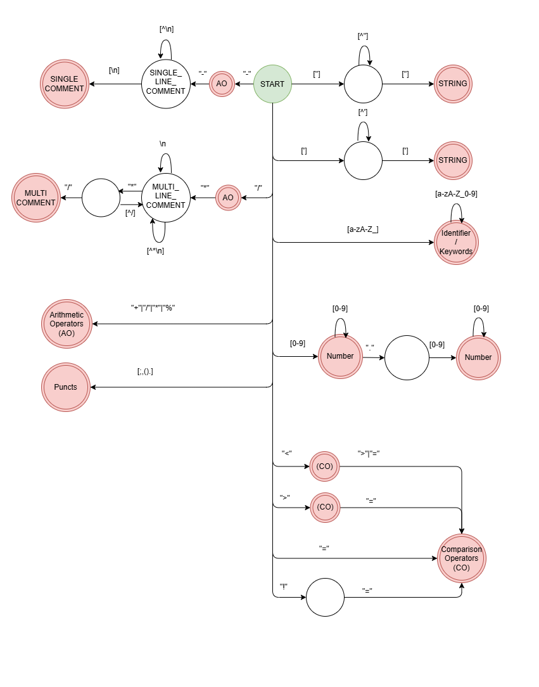

<div align="center">
    
</div>

# flex-sql-lexer

A lexical analyzer for SQL statements implemented in C using Flex.

## Key Concepts

- **Keywords and Identifiers:** Distinguishes SQL reserved words from names of tables and columns.
- **Numbers and Strings:** Recognizes integer and floating-point numbers, as well as single-quoted and double-quoted strings.
- **Operators and Punctuation:** Identifies comparison operators, arithmetic operators, commas, semicolons, parentheses, and dots.
- **Comments:** Handles single-line comments (`--`) and multiline comments (`/* ... */`) using Flex start conditions.
- **Whitespace:** Ignores spaces, tabs, and newlines during tokenization.
- **Regular Expressions:** Defines patterns for token categories and uses Flex to generate the lexical analyzer.

## Example

**Input:**

```sql
SELECT name, age FROM Students WHERE age >= 18;
```

**Output:**

```text
KEYWORD: SELECT
IDENTIFIER: name
PUNCT: ,
IDENTIFIER: age
KEYWORD: FROM
IDENTIFIER: Students
KEYWORD: WHERE
IDENTIFIER: age
COMPARISON OPERATOR: >=
NUMBER: 18
PUNCT: ;
```

## Build and Run

```bash
flex -o lex.yy.c sql.l
gcc lex.yy.c -o sql.exe
./sql.exe
```

## License
[LICENSE](./LICENSE)